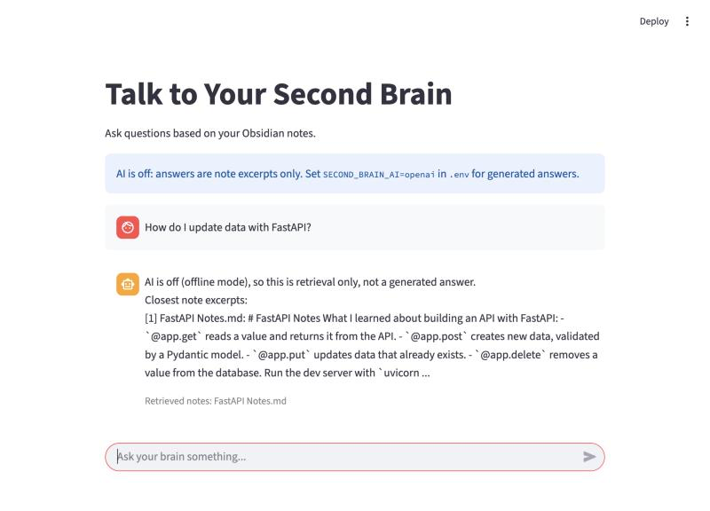

# Second Brain AI

Chat with your Obsidian-style markdown notes. Notes are chunked into a local Chroma
vector store; every answer lists the note excerpts retrieved for it.



*Offline mode, answering from `sample_vault/`.*

## Modes

The app is offline by default. AI is an optional connector you switch on in `.env`.

| `SECOND_BRAIN_AI` | Retrieval | Answers | Network |
| --- | --- | --- | --- |
| `off` (default) | Keyword overlap (hashed bag of words, no semantics) | The matching note excerpts, no generated text | None by design (not enforced by a test) |
| `openai` | OpenAI `text-embedding-3-small` | `gpt-4o-mini`, instructed to cite notes as `[n]` | OpenAI API, needs `OPENAI_API_KEY` |

`off` mode sends nothing off your machine. `python brain_chat/main.py streamlit` binds the UI
to localhost with Streamlit usage stats off. A bare `streamlit run` listens on all interfaces
(Streamlit's default), so use the launcher for your own notes. Offline answers are shown as
plain text, so a note that embeds a remote image does not fetch it.

Each mode keeps its own Chroma collection, so run ingest again after switching.

## Setup

Tested locally on Python 3.9 and 3.12 (macOS). Run every command from the repo root.

```bash
git clone https://github.com/Pranavojhaa/Second_Brain.git
cd Second_Brain
python3 -m venv .venv
source .venv/bin/activate
pip install -r requirements.txt
python brain_chat/ingest.py
python brain_chat/chat_with_vault.py
```

For the exact package versions tested on Python 3.12, install with the lock file instead:
`pip install -r requirements-dev.txt -c requirements-lock.txt`.

`sample_vault/` holds three example notes and is used when `vault/` does not exist.
Try `how do I update data with fastapi?`.

Streamlit UI:

```bash
python brain_chat/main.py streamlit
```

### Public demo

`brain_chat/demo_app.py` runs the same UI over `sample_vault/` only: offline mode, no API key,
and it ignores `.env`, `vault/` and `VAULT_DIR`, so personal notes are never served. Its index
lives in the system temp folder. Try it locally:

```bash
streamlit run brain_chat/demo_app.py
```

To host it, deploy this repo on [Streamlit Community Cloud](https://share.streamlit.io) with
`brain_chat/demo_app.py` as the main file. No secrets are needed. Questions typed into the demo
are stored in its temporary index as conversation memory; offline mode never shows them back.

### Use your own notes

Put markdown files in `vault/` (gitignored, used automatically when it exists) or point
`VAULT_DIR` at an existing Obsidian vault, then run `python brain_chat/ingest.py` again.

### Turn on OpenAI

```bash
cp .env.example .env
```

Set `SECOND_BRAIN_AI=openai` and `OPENAI_API_KEY=...` in `.env`, then re-run ingest.

## Configuration

| Variable | Default | Purpose |
| --- | --- | --- |
| `SECOND_BRAIN_AI` | `off` | `off` or `openai` |
| `OPENAI_API_KEY` | unset | Required only when `SECOND_BRAIN_AI=openai` |
| `VAULT_DIR` | `vault/` if present, else `sample_vault/` | Folder of `.md` notes |
| `CHROMA_DIR` | `chroma_db/` | Local vector store |

## How memory works

- **Source notes vs conversation memory.** Every stored chunk is tagged `kind=note` or
  `kind=conversation` (plus `source`, `type`, `timestamp`). They are retrieved separately.
  Only notes are numbered, cited, and listed under "Retrieved notes". Earlier chat turns are
  passed to the model as context and labelled as not citable.
- **Citations.** Retrieved notes lists every note retrieved for the question, not only the
  ones the answer used. `[n]` markers are checked, not whether the cited note supports the
  claim. In `openai` mode the model is told to cite `[n]` per claim, numbered as the notes
  were shown to it. A marker with no matching note gets
  `(Marker [k] does not match any retrieved note; treat that claim as unsourced.)`, and an
  answer with no valid marker is marked as unsourced. Valid markers are listed under
  "Cited in answer (pointer only, not checked against the claim):" as `[n] source — excerpt`.
  Offline answers are the numbered excerpts themselves, so that block is not shown.
- **Incremental ingest.** Each note's SHA-256 is stored with its chunks. Re-running ingest
  skips unchanged notes, replaces the chunks of edited notes, and removes deleted notes.
  An interrupted run is repaired on the next run. If the scan finds no notes but the store
  has some, ingest refuses instead of wiping them. Directories named `*.md` are skipped.
- **Memory write-back.** Your questions (and, in `openai` mode, the answers) are stored as
  conversation memory. In `openai` mode a close match from your own earlier messages is
  recalled; the model's past answers are never attributed to you.
- **Possible-tension hint.** In `openai` mode only, if one of your own earlier messages
  shares at least two content words with the question and takes the opposite stance
  ("should" / "should not", "want" / "not want", "prioritize" / "deprioritize"), the prompt
  gets at most one line: "Possible tension (keyword heuristic, unverified): an earlier
  message of yours says '...'". The model is told to raise it as a question only if it is
  real. Notes are never checked. It is an unverified keyword heuristic and is never stored.

## Limitations

- Offline mode matches exact words only: no stemming or synonyms, 256 hash buckets
  (unrelated words can collide). No semantic search, generated answers or recall offline.
- `openai` mode is tested only with a stub model and fake embeddings. It sends your note
  chunks (at ingest) and your questions, retrieved notes and conversation memory (at chat)
  to OpenAI.
- Citations point at a retrieved note; nothing checks that the note supports the claim.
- The tension hint compares whole messages, so a multi-sentence message can mis-pair.
  Expect false positives and misses.
- Conversation memory is stored unencrypted in `chroma_db/`, grows without limit, and is
  cleared only by deleting that folder (which also deletes the note index).
- Notes are read as plain text: no wikilinks, tags or frontmatter; dot-folders are skipped.
- Running two ingests at once can leave duplicate chunks for a note. Run one at a time.
- `scripts/summarize_note.py` rewrites the note in place and prepends a new AI summary on
  every run, so back the note up first. The summary is then ingested and can be cited as if
  it were your own note text. The write is atomic, but there is no undo and no test.
- Removing every note makes ingest refuse; delete `chroma_db/` to start over.

## Tests

Offline, no API key: fake embeddings, a stub chat model, and a temporary Chroma store.
Tests block outbound Python socket connections, which proves the test suite runs offline,
not that the app never touches the network.

```bash
pip install -r requirements-dev.txt
python -m pytest -q
```

`.github/workflows/tests.yml` runs the suite on Python 3.9 and 3.12 (ubuntu-latest) on every
push and pull request; it was also verified locally on both versions (macOS). The 3.12 job
installs with `-c requirements-lock.txt`, a freeze taken on macOS; Linux-only dependencies
(e.g. watchdog) are unpinned.

## Project structure

```text
brain_chat/
  core.py               # Ingest, retrieval, memory, prompt building
  ingest.py             # Sync the vault into Chroma
  chat_with_vault.py    # CLI chat
  second_brain_gui.py   # Streamlit UI
  demo_app.py           # Public demo: same UI over sample_vault/, offline
  main.py               # Launcher: python brain_chat/main.py [ingest] [streamlit]
scripts/
  summarize_note.py     # Optional, openai only: prepends an AI summary, rewriting the note in place
sample_vault/           # Example notes
tests/                  # Offline test suite
.streamlit/config.toml  # Streamlit usage stats off (repo-root launches)
```

## Troubleshooting

- `No notes ingested yet`: run `python brain_chat/ingest.py`.
- `SECOND_BRAIN_AI=openai but OPENAI_API_KEY is missing`: add the key to `.env`.
- `No .md notes found in <dir>; refusing to remove N indexed notes.`: check `VAULT_DIR`;
  if you really removed every note, delete the `CHROMA_DIR` folder it names (this also erases
  conversation memory) and re-run ingest.
- Upgrading from an older checkout: delete `chroma_db/` and re-run ingest. The old store
  used a different layout.
